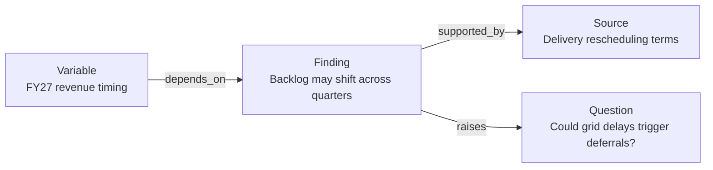

# PremiseDB

**A growing knowledge graph for investment research agents.**

[](LICENSE)
[](https://www.python.org/)

[Quickstart](#quickstart) · [Python API](docs/python-api.md) · [Design](docs/database-spec.md) · [Contribute](#contributing)

Give your agents a shared memory of **what they know, why they believe it, and what they still need to find out**.

PremiseDB stores research as connected companies, sources, findings, questions and model assumptions. Agents can recall prior work, follow its connections and revise their understanding as new evidence arrives. What one agent learns becomes available to the next, across sessions and investigations.

An embedded Python library, backed by SQLite. No required third-party runtime dependencies. MIT licensed.

> **Early MVP.** The graph store and document-retrieval pipeline work today through Python. Agent skills, MCP integration and vector search are on the roadmap. The API and database format are still evolving.

## Follow the connections

An agent researching a supplier's backlog learns that customers can postpone deliveries. It saves the evidence, the implication for revenue timing, and an unresolved question about customers' exposure to grid delays.

A later investigation can pick up that entire line of reasoning. A search for **backlog** becomes a path to **grid constraints**, **delivery terms** and **the assumptions in a revenue forecast**.



*A fictional research example. Agents author the findings and connections; PremiseDB stores them and makes them retrievable.*

The same pattern supports company coverage, thesis reviews and financial model assumptions:

| Research question | What the graph gives your agent a path to inspect |
| --- | --- |
| What do we already know about this company? | Earlier findings, their sources and unresolved questions. |
| What could this disclosure change? | Connected conclusions and assumptions to reassess. |
| What supports this forecast? | The research behind a model variable, including gaps in the evidence. |

## Quickstart

Requires **Python 3.12+**, linked against **SQLite 3.51.3+ with FTS5**. Check your Python's SQLite version with `python -c "import sqlite3; print(sqlite3.sqlite_version)"`.

Install from source:

```bash
git clone https://github.com/Implied-Capital/PremiseDB.git
cd PremiseDB
python -m venv .venv
source .venv/bin/activate
python -m pip install -e .
```

This example runs locally without an API key. It uses fictional research to show the two sides of the workflow.

**1. Save what an investigation learned.**

```python
from premisedb import RecordStore

with RecordStore("research.sqlite") as db:
    source = db.ingest_source(
        description="PowerFrame delivery terms (fictional)",
        document_text="Customers may reschedule deliveries with 90 days' notice.",
        author_id="agent-a",
    )
    finding = db.create(
        "Finding", text="PowerFrame's backlog may shift into later quarters.",
        attributes={"basis": "inference"}, author_id="agent-a",
    )
    question = db.create(
        "Question", text="Could grid delays cause customers to defer orders?",
        author_id="agent-a",
    )
    db.create_link(finding.id, source.id, "supported_by", author_id="agent-a")
    db.create_link(finding.id, question.id, "raises", author_id="agent-a")
```

**2. Start a fresh session and follow the research.**

Run this in another Python process, from the same directory. It needs only the database:

```python
from premisedb import RecordStore

with RecordStore("research.sqlite") as db:
    finding = db.search_records("PowerFrame backlog", kind="Finding", limit=1)[0]
    print(finding.text)
    for link in db.connections(finding.id).links:
        print(f"{link.relation}: {db.read(link.to_id).text}")
```

Output:

```text
PowerFrame's backlog may shift into later quarters.
supported_by: PowerFrame delivery terms (fictional)
raises: Could grid delays cause customers to defer orders?
```

**The grid question contains neither “PowerFrame” nor “backlog.”** The connection makes it discoverable. The next agent can investigate it, add evidence and update the finding, without access to the original conversation.

See the [Python API guide](docs/python-api.md) for updates, incoming connections, relation filters and document retrieval.

## Research memory and document evidence

An investigation needs both the understanding accumulated by earlier agents and the source material to check it against. PremiseDB provides two complementary retrieval paths:

| Path | Operations | Returns |
| --- | --- | --- |
| **Prior research** | `search_records()` → `connections()` → `read()` | Findings and related records, with named links the agent can follow. |
| **Source evidence** | `search_documents()` or `retrieve()` | Original source passages or selected excerpts, with Source IDs and exact byte ranges. |

Today, the calling agent composes these paths: find a relevant claim, follow its source link, then search within that source using `source_ids`. Automatic assembly of connected research context is a next step.

The document pipeline incorporates **Contextual Chunk Headers (CCH)** and **Relevant Segment Extraction (RSE)** from [dsRAG](https://github.com/D-Star-AI/dsRAG):

```text
Extracted text → passages + document context → BM25 → reranking → RSE → excerpts
```

- **Context that travels with the passage.** CCH adds a document title and a summary of the document to each passage's search representation and reranking input. You or your agent supply that context. The original source text stays separate and unchanged.
- **Excerpts sized to the evidence.** RSE uses relevance scores to select contiguous source ranges under a caller-defined token budget. A returned excerpt can span several passages, with an exact locator back to the source.
- **Replaceable scoring.** Use Jev, Cohere or Voyage through `OpenRouterReranker`, or implement the small `Reranker` interface for your own provider. Built-in Cohere and Voyage adapters use dsRAG's score transforms before RSE.

Ingestion accepts extracted text; call `chunk_source()` to make its body searchable. Local BM25 search needs no model. OpenRouter reranking sends the query, candidate text and document context to the selected provider.

[Ingest and search documents](docs/python-api.md#ingest-source-text) · [Configure retrieval](docs/python-api.md#retrieve-evidence) · [Validation and limits](docs/rse-validation.md)

## Six record types. Flexible connections.

| Record | Purpose | Example |
| --- | --- | --- |
| **Entity** | Something the research is about. | A company, facility, product or commodity. |
| **Source** | Material used as evidence. | A filing, transcript or research note. |
| **Finding** | A statement or conclusion to build on or challenge. | Delivery flexibility may defer revenue. |
| **Question** | An unresolved issue worth investigating. | Which customers can postpone orders? |
| **Model** | A reference to a financial model. | An Excel forecast or Python valuation. |
| **Variable** | An identifiable model input, intermediate value or output. | FY27 revenue or a utilization assumption. |

Every record has an ID, text, flexible JSON attributes, a last editor and an updated timestamp. Connect any records with named relationships such as `supported_by`, `depends_on`, `contradicts` or `raises`. Links can carry an explanation of why the connection matters.

Findings can support or challenge other findings. Questions can connect several investigations. Model variables can point to the research supporting an assumption; calculations stay in your modeling tool.

Your agent supplies the meaning: label disclosed facts, inferences and scenario assumptions in metadata, and connect them to their basis. PremiseDB keeps current records and links, with updates replacing their contents. Captured source text stays fixed so evidence locators retain their meaning.

## Bring your own agents

The workflow is **Recall → Contribute → Revise**:

1. **Recall** relevant findings, follow their connections and inspect the evidence.
2. **Contribute** new findings, sources and questions, linked to the existing graph.
3. **Revise** current understanding when evidence changes. Keep competing interpretations explicit as separate findings when useful.

Use the Python API from your own agent tools or from scripts run by coding agents such as Codex and Claude Code. The agent decides what to investigate and what to record. PremiseDB provides the persistent graph and retrieval primitives.

The goal is the same whether you guide one agent or coordinate many: knowledge accumulates in a shared research workspace. Today, stores use separate SQLite connections on a local filesystem; large agent fleets and distributed deployments have not been validated. Packaged skills and an MCP server are planned.

## Where we are going

The working foundation includes records and links, BM25 search, text ingestion, document-level CCH, configurable reranking and token-budgeted RSE. The next layers are:

- **Connected research retrieval:** assemble useful prior findings, evidence and open questions around a query.
- **Semantic search:** add embeddings and Faiss alongside SQLite's lexical index.
- **Agent integrations:** make the research loop easy to adopt through skills and MCP.
- **Document preparation:** add parsing and automatic context generation.

The [design specification](docs/database-spec.md) describes the broader direction; the [Python API guide](docs/python-api.md) documents what is implemented. Early database formats may change and currently have no migrations.

## Contributing

Try PremiseDB on one company or one research question. Show us where an agent reused earlier work, where it missed a useful connection, or what you had to build around the API. [Open an issue](https://github.com/Implied-Capital/PremiseDB/issues) with a small, shareable example.

We welcome retrieval evaluations, agent integrations and focused improvements to the core. Read [AGENTS.md](AGENTS.md) for the development conventions. Run the tests from the checkout:

```bash
python -m unittest discover -s tests -v
```

If you want to follow the project, **star the repo**. If you build something with it, we'd love to hear about it.

## License and foundations

[MIT](LICENSE). PremiseDB builds on retrieval ideas and adapted code from [dsRAG](https://github.com/D-Star-AI/dsRAG), with storage and indexing ideas informed by [minDB](https://github.com/D-Star-AI/minDB). See [NOTICE](NOTICE) for attribution and the [technical review](docs/dsrag-mindb-review.md) for the design background.
